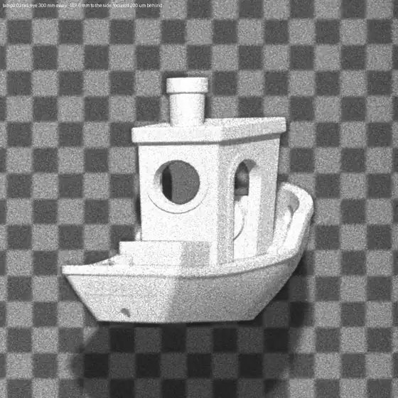
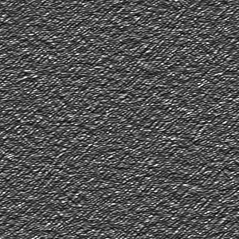

# holotrace

Compute off-axis (Leith–Upatnieks) image plane holograms of ray-traced scenes.



*A computed hologram 4 cm across (163,840² pixels, 0.25 µm apart), seen
by a simulated eye 30 cm away.*



*Its fringes: 300 × 300 pixels at the plate's middle, 75 µm across.*

The aim is the best hologram a computer can make, the test being that
optics in the scene still work. Look through a recorded magnifying glass,
and what is behind it is magnified, sharp, and changes as you move.

## How it works

The hologram is an exact coherent sum, not a stereogram or hogels, which
blur fine angular detail. Each point of the scene sends a wave to every
point of the plate it can reach; the plate records their sum against a
reference beam.

1. **Ray tracing ([Mitsuba 3](https://www.mitsuba-renderer.org/)).** For
   each point of the scene: whether it can be seen from each direction,
   how bright it is that way, and, where its light passes through lenses
   or off mirrors, how long the light's path is (which sets its phase).
2. **Coherent sum.** For each tile of the plate, add up every point's
   wave: brightness × visibility × e^(ik·path length) / distance.
3. **Output.** Add the reference beam, encode the fringes (binary or
   grayscale), and write tiles for printing.

A simulated eye, with a pupil and focus, looks at the result to
evaluate.

## Physical realization

So far these holograms exist only in the computer's imagination. I'm
looking for collaborators to help bring them into the physical world.
The hard part is the printing: the plate's pixels are 0.25 µm across,
its fringes mostly about 1 µm apart, over an area centimeters wide. If
you can write patterns that fine, or have an idea for doing it economically,
please get in contact.

## Running

```bash
uv run holotrace check        # Mitsuba works and can measure how far rays go
uv run holotrace magnifier    # step 1: a hologram of a magnifying glass
uv run holotrace mesh         # step 2: the lens as a mesh traced by Mitsuba
```

Results go to `out/`. Add `--gpu` to `magnifier` or `mesh` to sum the
light on an NVIDIA GPU with CuPy, many times faster:

```bash
uv run --extra gpu holotrace mesh --gpu
uv run --extra gpu holotrace solid      # step 3: a solid scene across the plate
uv run --extra gpu holotrace benchy     # 3DBenchy, the 3D printing test boat
uv run --extra gpu holotrace benchy --scale 5 --spacing 16   # a 1 cm plate, tiled, with recording planes
uv run --extra gpu holotrace benchy --scale 10 --spacing 32  # a 2 cm plate: 40 s on an 8 GB GPU from 2016
uv run --extra gpu holotrace benchy --scale 20 --spacing 40  # a 4 cm plate: about 2 min, 7 GB of memory
# A plate for a laser writer: 0.4 um pixels, the scene's light within 7 degrees, fringes no finer than 2 um.
uv run --extra gpu holotrace benchy --scale 48 --spacing 64 --pixel 0.4 --cone 7   # a 9.8 cm plate: 5.5 min, 21 GB of memory
# The boat at its printed size, 60 mm, for finest lines of 0.9 um: a 6.9 cm plate, 4.5 min.
uv run --extra gpu holotrace benchy --plate 68.8128 --scale 35.2947 --spacing 48 --pixel 0.3 --cone 7.8
# Wide plates: 0.25 um pixels, the scene's light within 35 degrees either way.
uv run --extra gpu holotrace benchy --plate 20.48 --scale 6 --spacing 12 --turn 15 --pixel 0.25 --cone 35 --slab 300
#   a 2 cm plate, the boat 1 cm long: about 4 min, the spectrum 13 GB on disk
# Plates too big for memory are summed plane to plane (see planes.py): groups of
# slabs carried a short way, then each group's plane to the plate in one go.
# HOLOTRACE_OUT=/path/on/a/fast/disk puts results there instead of out/: with it
# on an NVMe drive the 4 cm plate below takes 11 min with --rule.
# Each scene's brightness maps are kept beside its results, so a rerun skips Mitsuba.
uv run --extra gpu holotrace benchy --plate 40.96 --scale 16 --spacing 32 --pixel 0.25 --cone 35 --slab 300
#   a 4 cm plate, the boat 2.7 cm long: the spectrum 33 GB on disk, and up to 66 GB more while it is made
#   add --wall for a checkered wall behind the boat, which it hides in part and shadows, wide enough
#   that no edge of it is seen from anywhere: 46 min, and up to 174 GB of disk while it is made
#   The light falling on each point is worked out by Mitsuba's path tracer: soft shadows, darker
#   corners, and light bounced between surfaces. Add --rule for a simple rule instead, which is quicker.
uv run --extra gpu holotrace view benchy --focus 0   # a movie: eye moving side to side, up and down
uv run --extra gpu holotrace view NAME --eye 300     # ... seen by a real eye 30 cm away, 4 mm pupil
uv run --extra gpu holotrace view NAME --eye 300 --source 0.02   # ... lit by a source 2 cm across, 1 m off: far less speckle
uv run --extra gpu holotrace encode NAME            # the plate's pattern on its own pixels, clear or opaque (a PBM picture)
uv run --extra gpu holotrace encode NAME --levels   # ... or in 256 levels, for a relief in resist (a PGM picture)
uv run --extra gpu holotrace encode NAME --gds      # ... or the chrome's clear pixels as rectangles, in a GDSII file
uv run --extra gpu holotrace encode NAME --check    # ... or both replayed: how much of the light becomes the scene's
uv run --extra gpu holotrace testplate              # two small plates to try a writer on: thin lines, levels, small holograms
uv run --extra gpu holotrace speckle    # step 4 (parked): phases optimized against speckle
uv run --extra gpu holotrace gpucheck   # the GPU's sum against the CPU's
```

Mitsuba itself runs on the GPU only on NVIDIA cards of compute
capability 7.5 or newer (Turing onward); on older cards and other
machines it runs on the CPU, more slowly. The GPU sum (CuPy) works on
older cards too.

[DESIGN.md](DESIGN.md) explains how it works, why, and what each
optimization bought.

## License

GPL-2.0-only: see [LICENSE](LICENSE). The 3DBenchy model in
`scenes/3dbenchy` is public domain (CC0); see its `SOURCE.md`.
