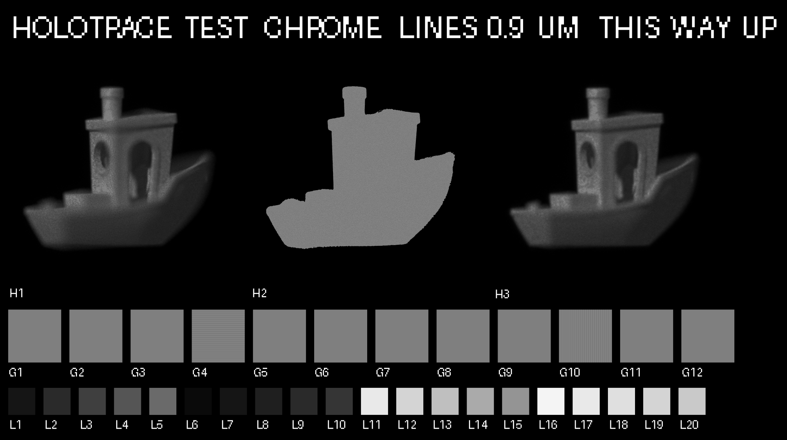
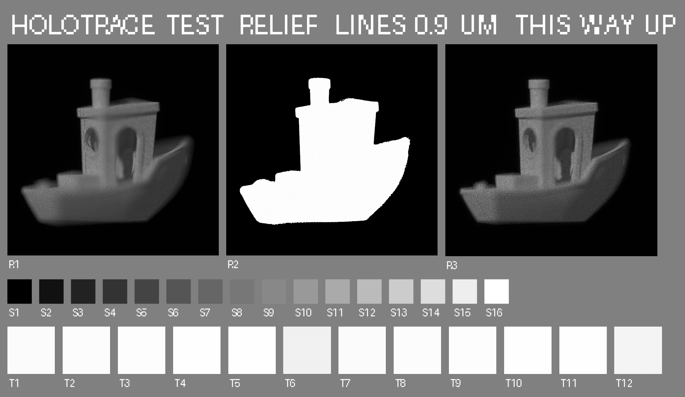

# Using the Heidelberg laser writer

The writer is a Heidelberg laser beam writer, taken here to be a DWL
66FS, with finest lines of 0.9 µm. This information is from Heidelberg's
manuals as other sites publish them (linked at the end).

## Goals

1. Learn how a hologram gets into the machine: which file, on which
   pixels.
2. Write the chrome test plate.
3. Write a relief test plate.
4.  Bring home numbers: how wide the lines came out, how deep the
   levels.

The boat at its printed size (a 68.8 mm plate, 6.5 to 24 hours of
writing by the manuals' rates) is for a later visit.

## Ask before going

The answers may mean making the files again, which takes minutes but
needs the computer with the GPU.

We know there are three write heads, and the finest writes 0.9 µm. 
There is a gray-scale option, of 256 levels in resist.

1. **What file do you give the machine for a hologram that is clear or
   opaque?** The manual's converter takes GDSII, and the test plate is
   ready as one: 1.4 GB, 22.9 million rectangles. Will a file that size
   convert? Is there a limit to the number of shapes? (One site's rules
   allow a million corners in a whole design; Heidelberg's guide, a
   million to a polygon.)
2. **Can the gray-scale option take one large picture, and in which
   format?** A hologram of many levels is a picture with a level from 0
   to 255 at every pixel: 7,000 pixels square for the small boat,
   28,672 square for one hologram of the test plate, 92,909 × 53,876
   for the whole plate (on 0.3 µm pixels). It is ready as a PGM, and
   can be written in whatever format is wanted.

   GDSII is not likely to be the answer. It says where there is a shape
   and where there is none, and the manual's converter takes it only
   for plates of that kind. For gray scale the manual has two ways in.
   One is a drawing (DXF) with a layer for each level, which does not
   suit a hologram: the small boat alone would be 17.4 million
   rectangles, against 0.6 million as chrome. The other is a picture
   (BMP), but of at most 1000 × 1000 pixels, repeated across the plate.
   So what to find out is whether this machine's software takes a
   bigger picture than the manual's does.

   Two more go with it. Which way round are the levels: does 255 leave
   the most resist, or the least? And is there a gray-scale file that
   has worked, with the settings it was converted with? It would answer
   this whole question, and the next.
3. **Are the finest head's pixels 0.2 µm, and if not, what are they?**
   The machine writes a plate as rows of points, its pixels, with a
   spot wider than the points are apart. The 0.9 µm is what the spot
   can make; the pixels are finer. One site gives its 4 mm head two
   modes: pixels of 0.4 µm, with features and spaces down to 1.5 µm,
   or pixels of 0.2 µm, with features and spaces down to 1 µm. Lines
   and gaps of 0.9 µm point to the finer one. A gray-scale picture is
   put onto these pixels (or onto pixels twice or four times as big),
   so a hologram's picture is best made on them from the start, with
   nothing left for the converter to work out between its pixels and
   ours. The test plates are ready on 0.2, 0.3 and 0.4 µm. The chrome
   plate does not depend on the answer: the converter lays its
   rectangles on the machine's pixels itself.

One thing to confirm: **the relief needs a clear plate, with resist on
it more than 1.1 µm thick.** The picture's whole range is to come out one
wave of red light deep, 0.633 µm / (n − 1): about 1.06 µm in a resist that
slows light 1.6 times (n; with the resist's name it can be looked up).
One site's chrome plates carry about 0.5 µm of resist, too little, and
their chrome would stop the light. Making the depth come out right is a
matter of exposure, which is the owner's; the staircase on the plate
measures it.

Left for the visit: how the files come (a drive, formatted how, or a
network), what there is to look with (a red laser, best a He–Ne at
633 nm, wide enough to cover 9 mm; a power meter; a microscope; the
Zygo), and how long things take (each test plate is 38 minutes to 2.4
hours of writing, by the manuals' rates for its area alone).

## Bring

- The files, 25 GB of them, on a drive of 32 GB or more. Not FAT32: it
  cannot hold a file over 4 GB.
- This page and `layout.txt` of each plate, on paper.
- A red laser pointer, and a small lens to spread its beam.
- A ruler, a card to catch spots on, a camera that focuses close.

## The files

They are too big for the repository. On the computer that made them
they are in `/mnt/holoscratch/prints`:

| Folder | What | Pixels | `chrome.gds` | `chrome_lines.gds` | `chrome.pbm` | `relief.pgm` |
|---|---|---|---|---|---|---|
| `boat` | a boat 2.1 mm wide, to try the way in with | 0.3 µm | `boat.gds`, 37 MB | | `boat.pbm`, 6 MB | `boat.pgm`, 47 MB |
| `testplate` | the two test plates | 0.3 µm | 1.37 GB | 1.9 MB | 0.60 GB | 4.66 GB |
| `testplate-0.2um` | the same | 0.2 µm | 2.13 GB | 3.7 MB | 1.36 GB | 10.52 GB |
| `testplate-0.4um` | the same | 0.4 µm | 1.01 GB | 1.2 MB | 0.34 GB | 2.62 GB |

Three sizes of pixel because the machine's own are not known (question
3; 0.2 µm is the likeliest). For chrome, take `testplate`. For the relief, whichever matches.
The three are not the same test: every line and tooth is a whole
number of pixels, so their widths differ (each `layout.txt` says).

To copy them, and to check the copy:

```bash
cd /mnt/holoscratch/prints
rsync -av --exclude 'benchy-*' SHA256SUMS boat testplate testplate-0.2um testplate-0.4um /path/to/the/drive/
cd /path/to/the/drive && sha256sum -c SHA256SUMS
```

What the files mean:

- All show the plate **as the viewer sees it**, the words along the
  top upright.
- `chrome.gds`: rectangles where the plate is to be **clear**. One
  structure (`PLATE`), layer 1, to the nm, the plate's middle at the
  origin. On positive resist over chrome that is the converter's "non
  invert": the rectangles are exposed, and the chrome under them etched
  away. Around the pattern the plate stays chrome.
- `chrome_lines.gds`: the chrome plate without its three holograms,
  which are nearly all of its rectangles: the gratings, the ladders and
  the words, where `chrome.gds` has them.
- `chrome.pbm`: the same as `chrome.gds` as a picture, a bit a pixel,
  top row first, black for chrome.
- `relief.pgm`: a byte a pixel, top row first. The value is how far
  the pixel holds the light back, in 256ths of a wave: more is more
  resist. 128 where there is nothing. All 256 make one wave: in resist
  that slows light 1.6 times (a guess until the resist is named) that is 1.06 µm
  from lowest to highest (633 nm / 0.6).

## The plates



**Chrome**, 28.9 × 16.2 mm. H1 to H3 are holograms of the boat, about
7 mm long: as holotrace would make it; "bold", flat, with no thin
lines; and with its light in a narrower cone. G1 to G12 are gratings
2 mm square, lines as wide as their gaps, lying (as a hologram's
fringes do) and standing. L1 to L20 are ladders 1 mm square of single
thin lines, clear on chrome and chrome on clear.



**Relief**, 27.9 × 16.2 mm. R1 to R3 are the same three holograms (the
picture shows how deep their fringes are). S1 to S16 are flat squares
1 mm wide, a staircase of levels from 0 to 255. T1 to T12 are sawtooth
gratings 2 mm square, each tooth a ramp through all the levels.

## At the machine: chrome

The steps below are the University of Florida's, from the procedure it
gives users of its own DWL66fs, with Heidelberg's guides where they add
something. They are for following what is done and knowing where our
choices go in. The owner's machine, its software's version and the
owner's process may all differ, and the machine is the owner's to run.

**What to write, in order.**

1. `boat.gds`, the small boat: to prove the way in, and then to find
   the dose and focus. Heidelberg's guide finds both by writing one
   pattern in a row of fields, each with another energy or focus. The
   boat is 2.1 mm wide: about a minute's writing each time, by the
   manuals' rates.
2. `chrome_lines.gds`, the gratings and ladders. If only this goes in,
   the visit still measures the writer's lines.
3. `chrome.gds`, the whole plate, in place of 2 if it converts.

**Converting**, on the computer beside the writer (Linux, the
"Conversion Job Manager"):

1. Copy the file into the folder for GDSII files. That site allows
   names of letters, digits and underscores only, at most 20 long, and
   no structure named `main`. Ours fit.
2. Start the program; then File, New Job, and name the job.
3. In the Source File frame press Add, choose GDSII, and pick the file.
   The Design Options window opens.
4. Structure: `PLATE`. Layer: 1. Press Create Default.
5. **Write Lens**: the head and its mode. This sets the pixels
   (question 3).
6. **Automatic Centering** on. The design's origin is the plate's
   middle already.
7. **Mirror** off. The pattern then reads the right way from the chrome
   side, which becomes the viewer's. (That site mirrors its masks,
   which are used face down.)
8. **Inverted** off: the rectangles are what the laser exposes. With
   Fill on, the preview shows it: "resist removed for positive
   photoresists".
9. **Spot size correction** none this first time, if the owner agrees:
   the ladders are there to measure what the writer does unaided. (That
   site uses none in the finer mode anyway.)
10. Press Preview and compare with the picture. Layer Info counts the
    polygons and their corners: write the numbers down.
11. Press Complete Tasks, then OK, and wait. Note how long converting
    takes. Then Transfer sends the result to the writer.

If a file will not convert, the number of its shapes is the likely
reason (question 1). Four corners to a rectangle, ours have:

| File | Rectangles | Corners |
|---|---|---|
| `chrome_lines.gds` | 30,455 | 122 thousand |
| `boat.gds` | 611,048 | 2.4 million |
| `chrome.gds` | 22.9 million | 92 million |

**Writing.**

1. The right head is in the machine, and the software in its mode
   (shown at the top right; changed by picking the mode and "Load it").
2. Laser on. The way of focusing, as the owner has it.
3. Setup, New, Create Map.
4. Job, Make Job. In the sheet: −1 under "do"; under Design, the
   converted pattern (File, Design, Refresh, To Job).
5. **Defoc** and **Energy** for this plate and resist are the owner's
   numbers. In Heidelberg's guide Defoc runs from 0 to 4095, 2048 for
   none, about 5 nm a step; Energy is a percentage, in tens, with gray
   filters in the beam below 30%. Write both down.
6. Job, Run Job, Load. The plate goes on the chuck resist up. At that
   site "the left side of the stage (standing in front) is the bottom"
   of the pattern. Vacuum on, door shut, OK.
7. Focus. That site's head can focus only 5 mm or more in from the
   plate's edge: the pattern has to end 5 mm short of every edge, so a
   test plate needs 39 × 27 mm of plate at least.
8. Find Center (three or four minutes), then Expose. Note the time.
9. **Mark the plate's top edge** when it comes out: the edge the words
   run along.

**Developing and etching** are the owner's process. For comparison,
that site's, for its own plates (530 nm of AZ1518 resist on chrome): a
minute in 300MIF developer, a rinse, blown dry; a look under the
microscope; 1 minute 45 seconds in Transene Chrome Etch 1020; a rinse;
the resist stripped. Write down what was used (the table below).

## Looking at the chrome plate

**Under the microscope.** Which of L1 to L5 (clear lines 0.3, 0.6, 0.9,
1.2, 1.5 µm wide) are there at all, and which of L11 to L15 (chrome
lines, the same widths)? Are G1 to G6 lines and gaps, or filled in?
Take pictures.

**With the laser, the gratings.** Send the beam straight through one
and catch the spots on a card: above and below the middle one for a
lying grating (G1 to G6), to its sides for a standing one. The beam
must fall on one square only; a hole in a card narrows it. With lines
as wide as the gaps, each of
the two first spots has a tenth of the light that fell on the grating
(1/π²), the middle one a quarter, and there is no second spot. A second
spot, or first spots much dimmer than two fifths of the middle one,
says the lines did not come out as wide as the gaps. These are for
0.3 µm pixels and 633 nm, by the simple rule (rough for the finest):

| Gratings (lying, standing) | Lines and gaps | First spot at |
|---|---|---|
| G1, G7 | 0.6 µm | 31.8° |
| G2, G8 | 0.9 µm | 20.6° |
| G3, G9 | 1.2 µm | 15.3° |
| G4, G10 | 1.5 µm | 12.2° |
| G5, G11 | 1.8 µm | 10.1° |
| G6, G12 | 2.4 µm | 7.6° |

**The ladders.** Their first spots are at 10.1° (L1 to L5, L11 to L15:
lines 3.6 µm from one to the next) and 5.0° (the rest: 7.2 µm). How
bright the first spot is against the middle one says how wide the
lines came out, whatever the glass loses. For clear lines on chrome,
3.6 µm apart, by the same rule:

| Line came out | First spot ÷ middle spot |
|---|---|
| 0.3 µm | 0.98 |
| 0.6 µm | 0.91 |
| 0.9 µm | 0.81 |
| 1.2 µm | 0.68 |
| 1.5 µm | 0.55 |

**The holograms.** Stand the plate upright, the words on top and
reading the right way: that side is the viewer's. Light it from behind
with a beam wide enough to cover the hologram, **climbing**: coming
from below the plate's middle and rising at 12.5° (H1, H2) or 9.6°
(H3). Look, or better point a camera focused on the plate, from in
front, straight on. The boat stands in the plate. It shows within 7.8°
of straight on (4 cm either way from 30 cm off); H3 within 5°. The beam
itself goes on rising and passes above: keep eyes out of it.

A laser of another red will do: the beam's angle changes with it (at
650 nm, 12.8° and 9.9°).

In the computer, lit like this and written exactly as drawn, H1 shows
the boat shaded, with 1.1% of the beam; H2 shows it flat and twice as
bright; H3 like H1 with less stray light. If H2 shows and H1 is flat or
patchy, the writer is not making H1's thin lines.

A chrome plate turned upside down shows a boat too, upside down and
inside out: its other image, not a fault.

## At the machine: relief

The manuals do not say how a relief is written. The Florida procedure
leaves it out, and Heidelberg's user guide says only to pick the
"grayscale" setup, where there is one, when the machine's configuration
is loaded. Heidelberg's converter guide does give the choices made when
a picture is converted, and these are where ours go in:

- **Set Gray Range**: which of the picture's values is the most. Ours
  run from 0 to 255; the converter expects 0 to 127 unless told.
- **Pixel Translation**: the size of the picture's pixels (0.2, 0.3 or
  0.4 µm).
- **Gray Pixel**: the machine's pixels, or twice or four times them.
- **Inversion**, and **invert LIC**: which way round (step 2 below).
- **use Graytable**: the table of which machine value to use for each
  level (see "Looking at it").

The way in is question 2. With it answered:

1. **The small boat first** (`boat.pgm`), as for chrome.
2. **Which way round.** In `relief.pgm` more is more resist. If the
   machine's values mean more light, and so less of a positive resist,
   the picture has to be inverted, there or at home.
3. **How deep.** The whole range is to come out one wave deep: about
   1.06 µm if the resist slows light 1.6 times, 0.99 µm for 1.64. The
   owner gives the machine 256 levels, as many as the file has. The
   manual's converter speaks of 128, and would take the file's two to
   one; Heidelberg's sheet for the newer DWL 66+ gives 128 to a basic
   gray-scale mode and 255 to an advanced one.
4. **If the manual's two ways are all there is**, the holograms
   probably cannot be written, but the staircase and the sawteeth can: each repeats, so
   each can be a picture of at most 1000 × 1000 pixels stepped over its
   square. holotrace does not write those pictures yet.

**Looking at it.** The Zygo on S1 to S16: the height of each square
above S1. That is the whole calibration: the manual's converter takes
a table of which machine value to use for each level ("graytable"),
and these sixteen heights fill it in. S1 should be lowest and S16
highest; the other way round, the levels are inverted.

The laser through T1 to T12: a sawtooth of the right depth with sharp
teeth sends all its light into one first spot, on one side. Light left
in the middle says the depth is off; light in the other spots, that
the teeth are rounded. First spots at 20.6° (T1, T7: teeth 1.8 µm),
15.3°, 10.1°, 7.6°, 5.0° and 3.8° (T6, T12: 9.6 µm), for 0.3 µm pixels.

The holograms as for chrome: R1 and R2 at 12.5°, R3 at 9.6°. In the
computer, as drawn, R1 has five times H1's light, and R2, flat, four
times R1's. A relief of the right depth has hardly any other image: if
the boat shows only with
the plate upside down, and then upside down and inside out, the levels
are inverted.

## Write down

| | Chrome plate | Relief plate |
|---|---|---|
| File, and how it was converted | | |
| Write head, mode, pixels | | |
| Inverted? Mirrored? Spot correction? | | |
| Dose, focus | | |
| Resist, its thickness; developer, time; etch | | |
| Time to convert, time to write | | |
| Laser used to look (wavelength, power) | | |

For each grating and ladder: seen under the microscope (yes, no,
filled in), the light in the middle spot, in each first spot, in any
second. For each of S1 to S16: its height. For each hologram: a
picture, and what the beam's angle was.

## What the answers decide

| Found | Then |
|---|---|
| The finest lines that come out as wide as their gaps | The widest cone the boat's light can have: lines of 0.8 µm allow ±9.0°, 0.9 µm ±7.8°, 1.0 µm ±6.7°, 1.2 µm ±5.2°, 1.5 µm ±3.7° (by holotrace's rule for the reference beam, DESIGN.md §6.6) |
| The thinnest single line that comes out | Whether chrome can show a scene's dim parts by thin lines, as H1 does, or needs another way |
| Lying against standing | Whether fringes should lie along the writer's scan or across it |
| The staircase's heights | The table of levels, and whether a whole wave of depth can be had |
| The sawteeth | How fine a relief's fringes can be and still be teeth |
| Time to convert and to write | Whether the full-size boat is a day's work, and in which format |

## Making the files again

On the computer with the GPU, one to five minutes each:

```bash
export HOLOTRACE_OUT=/mnt/holoscratch/prints
uv run --extra gpu holotrace testplate                # finest lines 0.9 um, pixels 0.3 um, into testplate
uv run --extra gpu holotrace testplate --pixel 0.2    # ... on pixels of 0.2 um, into testplate-0.2um
```

The small boat: `holotrace benchy --plate 2.1 --scale 1.025 --spacing
16 --pixel 0.3 --cone 7.8`, then `holotrace encode NAME` three times:
plain, with `--levels`, with `--gds`. Its three `pattern-0.3um` files
are copied into `boat` as `boat.pbm`, `boat.pgm` and `boat.gds`.

## The manuals

- [Conversion Job Manager software guide, v1.88 for the DWL66fs](https://nrf.aux.eng.ufl.edu/_files/documents/133.pdf)
  (Heidelberg Instruments, hosted by the University of Florida): the
  formats, inverting, the 128 levels, the pictures of 1000 × 1000.
- [DWL 66+ specifications](https://www.nanofab.utah.edu/wp-content/uploads/2022/12/DWL-66-Specs.pdf)
  (Heidelberg Instruments, 2019, hosted by the University of Utah): the
  newer model's gray-scale modes, of 128, 255 and 1000 levels.
- [DWL66fs User Guide 1](https://www.cnfusers.cornell.edu/sites/default/files/Equipment-Resources/DWL66fs_UG1_User_Guide_1.pdf)
  and [User Guide 2](https://www.cnfusers.cornell.edu/sites/default/files/Equipment-Resources/DWL66fs_UG2_User_Guide_2.pdf)
  (Heidelberg Instruments, hosted by Cornell).
- [Heidelberg DWL66fs procedure](https://nrf.aux.eng.ufl.edu/_files/documents/148.pdf?v=6)
  (University of Florida): the 4 mm head's pixels, 400 nm and 200 nm,
  and its rates.
